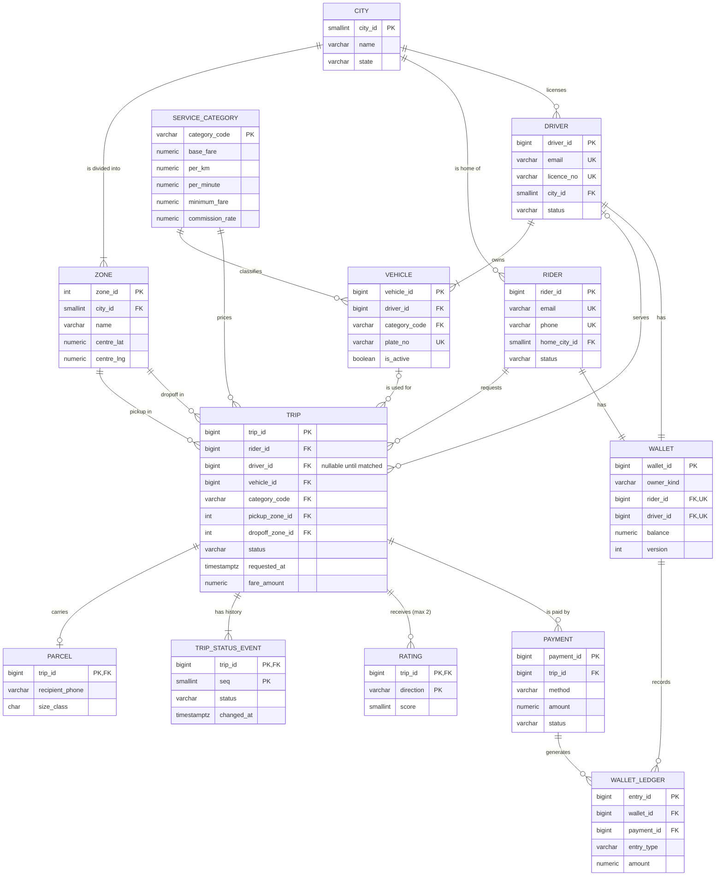

# Portfolio 1 — Database Design and Modelling

## 1. Selected case study: SwiftMove

| | |
|---|---|
| **Organisation** | **SwiftMove Technologies Ltd** — a *simulated* ride-hailing and on-demand parcel delivery platform operating in five Nigerian cities (Lagos, Abuja, Port Harcourt, Ibadan, Kano). |
| **Nature of the business** | Riders request a car (Economy, Comfort), a motorbike, or a van. A nearby approved driver accepts, completes the trip, and is paid. The same flow delivers parcels. SwiftMove keeps a commission (15–22%) on every trip. Riders can pay by in-app wallet, card or cash. |
| **Users of the database** | Riders (mobile app), drivers (driver app), dispatch/matching service, finance team (payouts, commission, reconciliation), operations and support staff, data analysts. |
| **Major data stored** | Cities and service zones, service categories and fare rules, riders, drivers, vehicles, trips and their status history, parcels, ratings, wallets, payments and an append-only money ledger. |
| **Key operations** | Register riders/drivers and vehicles; request, match, start, complete or cancel a trip; compute the fare; pay from a wallet (rider → driver + platform commission) or record cash; rate the other party; show trip history and driver earnings; reconcile wallet balances; city/zone revenue reporting; find nearby drivers (Portfolio 4). |

The same case study is used in all five portfolios.

## 2. ER diagram

GitHub renders this Mermaid diagram. The same diagram is in [`er-diagram.mmd`](er-diagram.mmd).



**Cardinalities worth noting**

- A trip has **0 or 1** driver: it is NULL while the trip is `requested`, or if it is cancelled before matching.
- A trip has **0 or 1** parcel. Only delivery trips have one, which is a 1:0..1 subtype.
- A trip has **at most 2** ratings, one in each direction. The composite PK `(trip_id, direction)` enforces this.
- A trip can have **many** payment attempts, but **only one successful** payment. A partial unique index enforces this.
- Each rider and each driver has **exactly one** wallet. The platform has exactly one wallet too.

## 3. Relational schema

Full DDL: [`schema.sql`](schema.sql) (PostgreSQL 17, schema `swiftmove`).

```
city(city_id PK, name, state, country_code, timezone)                         UNIQUE(name, state)
zone(zone_id PK, city_id FK→city, name, centre_lat, centre_lng)               UNIQUE(city_id, name)
service_category(category_code PK, description, seats, base_fare, per_km, per_minute, minimum_fare, commission_rate)
rider(rider_id PK, full_name, email UK, phone UK, home_city_id FK→city, status, created_at)
driver(driver_id PK, full_name, email UK, phone UK, licence_no UK, city_id FK→city, status, joined_at)
vehicle(vehicle_id PK, driver_id FK→driver, category_code FK→service_category, plate_no UK, make, model, model_year, is_active)
trip(trip_id PK, trip_type, rider_id FK, driver_id FK NULL, vehicle_id FK NULL, category_code FK,
     pickup_zone_id FK→zone, dropoff_zone_id FK→zone, pickup/dropoff lat-lng, status,
     requested_at, accepted_at, started_at, completed_at, cancelled_at, distance_km, duration_min, fare_amount)
parcel(trip_id PK FK→trip, recipient_name, recipient_phone, size_class, declared_value, proof_of_delivery)
trip_status_event(trip_id FK→trip, seq, status, changed_at)                    PK(trip_id, seq)
rating(trip_id FK→trip, direction, score, comment, created_at)                 PK(trip_id, direction)
wallet(wallet_id PK, owner_kind, rider_id FK UK NULL, driver_id FK UK NULL, currency, balance, version, updated_at)
payment(payment_id PK, trip_id FK→trip, method, amount, status, created_at, settled_at)
wallet_ledger(entry_id PK, wallet_id FK→wallet, payment_id FK→payment NULL, entry_type, amount, created_at)
view driver_rating(driver_id, avg_score, ratings)        -- derived, not stored
```

## 4. Keys and constraints

| Kind | Where | Why |
|---|---|---|
| **Surrogate PKs** (`GENERATED ALWAYS AS IDENTITY`) | rider, driver, vehicle, trip, wallet, payment, ledger | Natural keys like email and phone can change. Integer keys keep foreign keys and indexes small. |
| **Natural PKs** | `city_id`, `zone_id`, `category_code` | Small, stable reference data with meaningful codes. |
| **Composite PKs** | `trip_status_event(trip_id, seq)`, `rating(trip_id, direction)` | These are weak entities that only exist inside a trip. The composite key on `rating` also enforces "rate once per direction". |
| **Alternate keys (UNIQUE)** | rider/driver email and phone, `licence_no`, `plate_no`, `(city_id, zone name)` | These candidate keys must stay unique even though they aren't the PK. |
| **Foreign keys** | 19 FKs; `ON DELETE CASCADE` only on child/weak tables (parcel, status events, ratings) | Referential integrity. Money tables never cascade, so a payment can't silently disappear. |
| **CHECK — domains** | status enums, `score BETWEEN 1 AND 5`, fare ≥ 0, phone `^\+234[0-9]{10}$`, lat/lng ranges, `commission_rate ≤ 0.5` | Reject invalid values at the database. |
| **CHECK — business rules** | `ck_trip_matched` (accepted/started/completed trips must have a driver and vehicle), `ck_trip_completed` (completed ⇒ fare, distance, completion time), `ck_trip_timeline` (requested ≤ accepted ≤ started ≤ completed), `ck_wallet_owner` (exactly one owner per kind), `ck_wallet_balance` (rider wallets never negative), `ck_payment_settled` | Rules hold no matter which application writes the data. |
| **Partial unique indexes** | one active vehicle per driver; one *successful* payment per trip; a single platform wallet | Conditional uniqueness that a plain UNIQUE constraint can't express. |

Evidence that the constraints work: [`evidence/verify-output.txt`](evidence/verify-output.txt). Checks 6–8 deliberately try invalid writes, and each is rejected by the named constraint.

## 5. Normalisation

### Starting point: the unnormalised "trip report"

This is the kind of flat record an operations spreadsheet holds:

| trip_no | rider_name | rider_phone | rider_city | driver_name | driver_phone | plate | car | category | base_fare | per_km | pickup_area | pickup_city | statuses | ratings | amount | method |
|---|---|---|---|---|---|---|---|---|---|---|---|---|---|---|---|---|
| 1001 | Ada Okafor | +2348000000001 | Lagos | Tunde Bello | +2349000000007 | LAG-00007SM | Toyota Corolla | ECONOMY | 500 | 180 | Yaba | Lagos | requested 08:00, accepted 08:02, completed 08:40 | rider→driver 5, driver→rider 4 | 3,610 | wallet |

Problems: `statuses` and `ratings` hold several values each (a repeating group). Rider, driver, car and fare-rule facts repeat on every trip, which causes update, insert and delete anomalies:
- **Update:** changing a phone number means editing thousands of rows.
- **Insert:** you can't add a new driver who hasn't done a trip yet.
- **Delete:** deleting a rider's only trip loses the rider.

### 1NF — atomic values, no repeating groups

- `statuses` is split into **`trip_status_event(trip_id, seq, status, changed_at)`**, one row per status change.
- `ratings` is split into **`rating(trip_id, direction, score)`**.
- `car` becomes atomic `make` and `model` columns, and coordinates become separate lat and lng columns.
- Every table has a primary key.

### 2NF — no partial dependencies on a composite key

In 1NF, a table keyed on `(trip_id, seq)` that still carries `rider_name` or `fare_amount` has a **partial dependency**: those depend on `trip_id` alone. So:
- Trip-level facts stay in **`trip`** (key `trip_id`).
- `trip_status_event` keeps only what depends on the **whole** key `(trip_id, seq)`, namely `status` and `changed_at`.
- `rating` keeps only `score`, `comment` and `created_at`, which depend on `(trip_id, direction)`.

### 3NF — no transitive dependencies

These dependencies were transitive through a non-key attribute, so each became its own table:

| Transitive dependency | Resolution |
|---|---|
| trip → rider_id → rider_name, rider_phone, rider_city | `rider` table; trip keeps only `rider_id` |
| trip → driver_id → driver_name, licence | `driver` table |
| trip → vehicle_id → plate, make, model | `vehicle` table |
| trip → category_code → base_fare, per_km, per_minute, commission_rate | `service_category` table (fare *rules*) |
| trip → pickup_zone_id → zone name → city | `zone` table with `city_id`; `city` table |

After this, every non-key attribute in `trip` depends on *the key, the whole key, and nothing but the key*.

### BCNF

Every determinant in each table is a candidate key:
- `rider`: email and phone are candidate keys, which are UNIQUE. No other attribute determines anything.
- `zone`: the determinants are `zone_id` and `(city_id, name)`, and both are keys.
- `vehicle`: `plate_no` is a candidate key.

So the schema is in BCNF.

### Deliberate decisions (denormalisation and derived data)

1. **`trip.fare_amount` is stored**, even though fare rules could recompute it. This is deliberate: the fare must be the price *charged at the time*. If the rules change later, history must not change. Here fare_amount is a historical fact, not redundant data.
2. **`wallet.balance` is stored**, even though it equals the sum of `wallet_ledger`. This is a controlled redundancy for fast reads during payments, and money can only change it inside a transaction (Portfolio 3). `verify.sql` check 1 reconciles balance against the ledger.
3. **Average driver rating is *not* stored.** It is the `driver_rating` view. Storing it on `driver` would create an update anomaly every time a rating arrives.
4. **`trip.status` is stored** alongside `trip_status_event` for fast "current state" queries (e.g. open requests, Portfolio 2). The history table remains the source of truth for the audit.

## 6. Generated data

[`seed.sql`](seed.sql) generates deterministic synthetic data (`setseed(0.42)`), so anyone can rebuild exactly the same database. Real Lagos, Abuja, Port Harcourt, Ibadan and Kano neighbourhoods are used as zones.

| Table | Rows |
|---|---|
| trip | 1,000,000 (12 months, 10 Oct 2025 – 10 Oct 2026) |
| trip_status_event | 3,847,631 |
| wallet_ledger | 1,488,816 |
| rating | 988,933 |
| payment | 916,917 |
| parcel | 150,363 |
| rider / driver / vehicle | 50,000 / 5,000 / 5,300 |
| Database size | ≈ 1.07 GB |

Realism features:
- Lagos gets 50% of trips.
- Rider demand is skewed: a few riders take many trips.
- Each driver always drives a vehicle that matches the trip's category, in their own city.
- Fares follow the category's rules.
- About 10% of trips are cancelled.
- 2% of card payments fail before a successful retry.
- A small group of drivers is consistently rated lower.

## 7. How to run

```bash
. scripts/env.sh
./scripts/start-postgres.sh
psql -d postgres -c "CREATE DATABASE swiftmove"
psql -f portfolio-1-database-design/schema.sql -f portfolio-1-database-design/seed.sql   # ~1.5 min
psql -f portfolio-1-database-design/verify.sql
```

Evidence: [`evidence/seed-output.txt`](evidence/seed-output.txt), [`evidence/verify-output.txt`](evidence/verify-output.txt).
